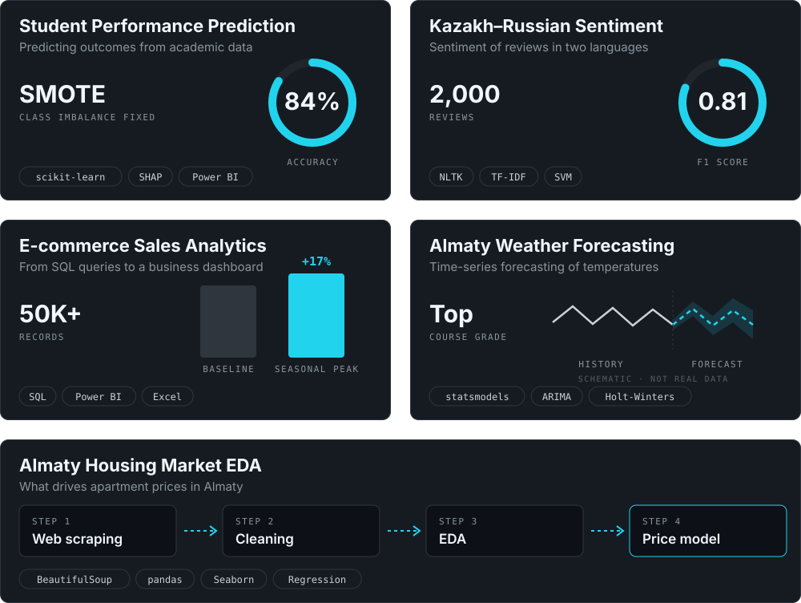
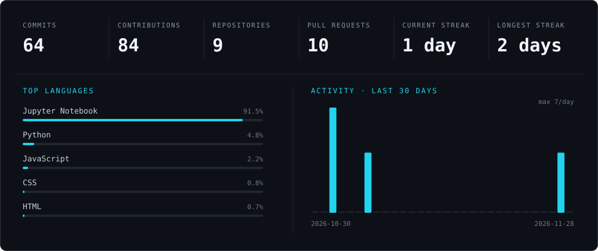

<!-- Header: assets/header.svg -->

  
  
  
  

### 👋 About me

- 🎓 4th-year **Data Science & Statistics** student at **SDU University**, Almaty
- 🤖 I build **machine learning pipelines**: data cleaning → EDA → modelling → explainability
- 🔎 Focus: **NLP**, **time series**, **statistical modelling**
- 🏫 Teaching Assistant · PhD Research Assistant · Tutor at Azat Academia
- 📖 Learning now: **Deep Learning & Transformers**
- 💼 Open to **Data Science / ML internships** and research roles

### 📁 Projects

### 🌐 Languages

### 🛠️ Stack

| Area | Tools |
|:---|:---|
| **Languages** | Python · SQL · R · Bash · LaTeX |
| **ML & statistics** | scikit-learn · XGBoost · LightGBM · statsmodels · NLTK · SHAP · Optuna |
| **Data & BI** | pandas · NumPy · Matplotlib · Seaborn · Plotly · Power BI · Tableau · Excel |
| **Databases** | PostgreSQL · MySQL · SQLite · MongoDB |
| **Tools** | Jupyter · VS Code · PyCharm · Git · Google Colab · Kaggle · Linux |

Methods

 

Linear / logistic regression · random forest · gradient boosting · SVM · naive Bayes · k-means · DBSCAN · PCA · TF-IDF · ARIMA · Holt-Winters · hypothesis testing · ANOVA · cross-validation · grid search · SMOTE

### 🎖️ Certifications

| Certificate | Details |
|:---|:---|
| **IBM Data Science** | IBM · Coursera · 2025 · [credential 1 ↗](https://coursera.org/share/d316159499c44181e397ee2eb21e4387) · [credential 2 ↗](https://coursera.org/share/c0773776b1257278488e7081cb31a256) |

### 💼 Experience

| Role | Where |
|:---|:---|
| Teaching Assistant | SDU University |
| PhD Research Assistant | SDU University |
| Tutor | Azat Academia · since 2023 |

### 📊 GitHub

<!-- Rendered by .github/workflows/stats.yml (scripts/generate_stats.py), served from the `stats` branch -->

---

📫 <a href="mailto:Hashick1812@gmail.com">Hashick1812@gmail.com</a> · <a href="https://t.me/rule_46">Telegram</a> · <a href="https://www.linkedin.com/in/islam-kuttybaev-106555416/">LinkedIn</a>

